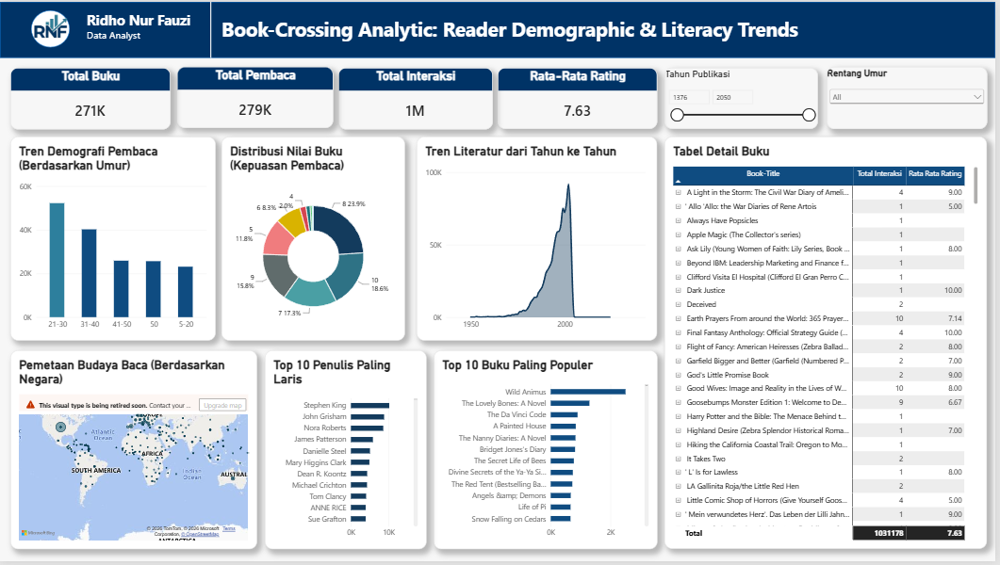

<p align="center">
  
</p>

<h1 align="center">📚 Book-Crossing: Reader Analytics & Hybrid Book Recommender System</h1>

<p align="center">
  <a href="https://www.python.org/"></a>
  <a href="https://scikit-learn.org/"></a>
  <a href="https://surpriselib.com/"></a>
  <a href="https://opensource.org/licenses/MIT"></a>
</p>

<p align="center">
Proyek end-to-end di atas dataset <strong>Book-Crossing</strong> yang terdiri dari dua bagian yang saling melengkapi: <strong>(1) Data Analytics</strong> berupa dashboard interaktif Power BI untuk membedah demografi pembaca dan tren literatur, serta <strong>(2) Data Science</strong> berupa sistem rekomendasi buku hybrid yang menggabungkan <strong>Content-Based Filtering</strong> dan <strong>Collaborative Filtering (SVD)</strong>.
</p>

**Author:** Ridho Nur Fauzi | Data Analyst & ML/DL Engineer / Data Scientist  
**Tools Used:** Power BI, Power Query, DAX, Python (pandas, numpy, scikit-learn, scikit-surprise, matplotlib, seaborn)  
**Dataset:** Book-Crossing Dataset (Users, Books, Book-Ratings)



---

## 📑 Daftar Isi

- [Akses & Download](#-akses--download)
- [Project Overview](#-project-overview)
- [Ringkasan Eksekutif](#-ringkasan-eksekutif)
- [Key Performance Indicators (KPIs)](#-key-performance-indicators-kpis)
- [Problem Definition & Karakteristik Dataset](#-problem-definition--karakteristik-dataset)
- [Data Cleaning & Preprocessing](#-data-cleaning--preprocessing)
- [Bagian 1: Analisis Dashboard Power BI](#-bagian-1-analisis-dashboard-power-bi)
- [Bagian 2: Eksplorasi Data & Visualisasi di Python](#️-bagian-2-eksplorasi-data--visualisasi-di-python)
- [Pendekatan Pemodelan](#-pendekatan-pemodelan)
- [Evaluasi Model](#-evaluasi-model)
- [Contoh Hasil Rekomendasi](#-contoh-hasil-rekomendasi)
- [Tech Stack & Alat](#️-tech-stack--alat)
- [Struktur Proyek](#-struktur-proyek)
- [Cara Menjalankan Proyek](#-cara-menjalankan-proyek)
- [Keterbatasan & Pengembangan Selanjutnya](#️-keterbatasan--pengembangan-selanjutnya)
- [Kontak](#-kontak)

---

## 🚀 Akses & Download

- 🌐 **Live Interactive Dashboard:** Jika Anda ingin mencoba fitur filter interaktif (*cross-highlighting*) pada dashboard ini secara langsung, silakan kunjungi tautan berikut: **[Buka Dashboard Interaktif di Power BI](https://app.powerbi.com/view?r=eyJrIjoiYjdkZWEzMzktYTRjZS00YjljLTgwYWUtYzI1MzcwNDg4NzhlIiwidCI6ImY4NjQ5NTQ2LTdjMTctNGNhMS1iMzcyLTI4Njg4NGRlZjRhOCJ9)**
- 📥 **Download Project File:** Anda juga dapat mengunduh file asli model Power BI (.pbix) untuk mempelajari struktur DAX dan *Star Schema*-nya di dalam folder `model/` pada repositori ini.
- 📓 **Notebook Python:** Seluruh proses cleaning, pemodelan, dan evaluasi sistem rekomendasi tersedia di `Book_Recommender.ipynb` (lihat [Cara Menjalankan Proyek](#-cara-menjalankan-proyek)).

---

## 📌 Project Overview

Proyek ini mengupas dataset Book-Crossing dari dua sudut pandang. Dari sisi **analitik**, dibangun *dashboard* interaktif menggunakan Power BI untuk memberikan wawasan mendalam (*insights*) mengenai demografi pembaca global, tren literatur dari tahun ke tahun, serta preferensi dan perilaku pengguna dalam memberikan penilaian (rating) terhadap buku. Dari sisi ***data science***, temuan dan pemahaman terhadap data tersebut dilanjutkan dengan membangun sistem rekomendasi buku yang mampu menghasilkan rekomendasi relevan secara konten sekaligus dipersonalisasi.

Proyek ini mencakup proses ***End-to-End Data Analysis***, mulai dari pembersihan data mentah (menangani *DataFormat.Error*, membersihkan nilai *Null/Blank*, memperbaiki kardinalitas *Many-to-Many*), pemodelan data (*Star Schema*), pembuatan *DAX Measures*, hingga visualisasi data yang interaktif. Proses tersebut diperluas dengan **pipeline data science** di Python: cleaning dan preprocessing, eksplorasi data, *content-based filtering*, *collaborative filtering*, sistem *hybrid*, hingga evaluasi model.

Sebagai catatan, dataset yang sama digunakan di kedua bagian, tetapi pembersihan data dilakukan terpisah sesuai kebutuhan masing-masing (Power Query untuk dashboard, pandas untuk pemodelan).

---

## 📊 Ringkasan Eksekutif

| Parameter | Detail |
|---|---|
| **Dataset & Ukuran** | Book-Crossing — 271.360 buku, 278.858 user, 1.149.780 rating |
| **Bagian Analytics** | Dashboard interaktif Power BI (Power Query, DAX, *Star Schema*) |
| **Sparsity Matriks User-Item** | 99,9967% (setelah thresholding: 12.720 user × 18.318 buku) |
| **Pendekatan Rekomendasi** | Hybrid: Content-Based (TF-IDF + Cosine Similarity) → Collaborative Filtering (SVD) |
| **Rating Eksplisit vs Implisit** | 433.671 eksplisit (1–10) vs 716.109 implisit (rating 0) |
| **Model Collaborative** | SVD (library `Surprise`), Cross-Validation 3-fold |
| **RMSE** | 3,5474 |
| **MAE** | 2,8136 |

---

## 📊 Key Performance Indicators (KPIs)

Berdasarkan data yang telah dibersihkan, komunitas Book-Crossing memiliki skala interaksi yang masif:

- **Total Pembaca:** 279.000 pengguna terdaftar.
- **Total Buku:** 271.000 judul buku unik.
- **Total Interaksi:** 1 Juta pemberian rating.
- **Rata-Rata Rating:** 7.63 (Skala 1-10, mengecualikan rating 0/tanpa nilai).

---

## 📑 Problem Definition & Karakteristik Dataset

### 1. Masalah & Tujuan

Proyek ini memiliki dua tujuan yang saling berkaitan.

**Analitik (Power BI):**
- Memahami demografi pembaca global, tren literatur dari tahun ke tahun, serta pola pemberian rating.

**Data Science (Python):**
- **Memprediksi rating** yang mungkin diberikan seorang user terhadap buku yang belum pernah ia baca.
- **Menghasilkan daftar Top-N rekomendasi** buku yang paling relevan untuk seorang user, dengan mempertimbangkan baik kemiripan konten buku maupun pola selera komunitas.

### 2. Tantangan Spesifik Dataset Book-Crossing

- **Implicit vs Explicit Feedback**: rating bernilai 0 (62% dari seluruh interaksi) menandakan user berinteraksi dengan buku tanpa memberi skor eksplisit, berbeda maknanya dari rating 1–10.
- **Data Sparsity ekstrem**: 99,9967% sel pada matriks user-item kosong — mayoritas user hanya merating 1 buku, dan mayoritas buku hanya dirating 1 kali.
- **Orphan Data**: 118.644 baris rating mengacu ke ISBN yang tidak terdaftar di tabel metadata buku.
- **Cold Start**: sulit merekomendasikan buku baru atau untuk user baru jika hanya mengandalkan collaborative filtering.

### 3. Struktur Data

- **Books**: ISBN, Book-Title, Book-Author, Year-Of-Publication, Publisher.
- **Ratings**: User-ID, ISBN, Book-Rating (skala 0–10).
- **Users**: User-ID, Location, Age.

---

## 🧹 Data Cleaning & Preprocessing

Pembersihan data dilakukan di kedua sisi proyek: di **Power Query** untuk kebutuhan dashboard, dan di **Python (pandas)** untuk kebutuhan pemodelan.

### A. Data Cleansing di Power BI (Power Query & DAX)

- **Data Type Enforcement:** Mengubah dan menstandarkan tipe data kunci (seperti `User-ID` menjadi Teks) untuk memastikan relasi *One-to-Many* yang valid antar tabel dan menghindari error pemformatan otomatis dari Power Query.
- **Handling Errors:** Membersihkan baris data yang cacat (*Remove Errors*) dan mengganti nilai usia yang tidak valid dengan nilai *Null*.
- **Data Sanitization:** Menerapkan fungsi *Trim* dan *Remove Duplicates* pada tabel dimensi (`BX-Users`) untuk memastikan integritas referensial.
- **DAX Implementation:** Menggunakan fungsi `CALCULATE` dan logika filter untuk mengecualikan rating bernilai `0` (implisit) agar tidak merusak perhitungan *Average Rating* yang sebenarnya.

### B. Data Cleaning & Preprocessing di Python

| Isu yang Ditemukan | Tindakan |
|---|---|
| 3 baris `Year-Of-Publication` mengalami pergeseran kolom (data shift) akibat parsing CSV | Diperbaiki manual, kolom dikembalikan ke posisi yang benar |
| Tahun terbit tidak valid (`0`, `2030`, `2050`, `1806`, dll — 4.633 baris) | Dikonversi ke numerik, nilai di luar rentang 1900–2026 dijadikan kosong |
| Umur user tidak masuk akal (`0`, `244`, dll — 1.248 baris) | Difilter ke rentang wajar 5–100 tahun |
| 118.644 baris rating dengan ISBN yang tidak ada di tabel Books (*orphan data*) | Dipisah jadi dua dataset: `df_ratings_content` (orphan dibuang, untuk content-based) dan `df_ratings_cf` (lengkap, untuk collaborative filtering) |
| Rating 0 (implicit) tercampur dengan rating eksplisit | Ditandai lewat kolom `Is-Explicit` agar bisa diperlakukan berbeda |
| Sparsity matriks user-item 99,9967% | Thresholding: hanya user dan buku dengan minimal 10 rating yang dipertahankan (→ 12.720 user, 18.318 buku, 443.196 rating) |

---

## 💡 Bagian 1: Analisis Dashboard Power BI

Berdasarkan visualisasi pada *dashboard*, berikut adalah temuan utama dari data analitik ini:

### 1. Demografi Pembaca Didominasi Dewasa Muda

Grafik **Tren Demografi Pembaca** menunjukkan bahwa mayoritas pengguna aktif berada pada rentang usia **21-30 tahun** (lebih dari 50.000 pengguna), disusul oleh kelompok usia **31-40 tahun**. Kelompok usia remaja (5-20 tahun) merupakan kelompok minoritas dalam dataset ini. Hal ini mengindikasikan bahwa target pasar utama untuk kampanye literasi atau promosi buku di platform ini adalah kalangan mahasiswa hingga pekerja muda.

### 2. Kepuasan Pembaca Sangat Tinggi (Positively Skewed)

Dari **Distribusi Nilai Buku**, terlihat jelas bahwa pengguna cenderung memberikan nilai yang sangat positif.
- Nilai **8** adalah rating yang paling sering diberikan (23.9% dari total interaksi).
- Nilai sempurna **10** menempati posisi kedua (18.6%).
- Sangat sedikit pengguna yang memberikan rating buruk (di bawah 5), yang menjelaskan mengapa rata-rata rating keseluruhan bertengger di angka tinggi (7.63).

### 3. Konsentrasi Geografis di Negara Barat

**Pemetaan Budaya Baca** memperlihatkan bahwa pengguna platform ini sangat terkonsentrasi di wilayah **Amerika Utara (Amerika Serikat & Kanada)** dan **Eropa**. Terdapat peluang besar untuk ekspansi platform atau kampanye literasi di wilayah Asia, Amerika Selatan, dan Afrika yang saat ini masih memiliki tingkat partisipasi pembaca yang rendah.

### 4. Dominasi Penulis Veteran di Puncak Popularitas

Pada **Top 10 Penulis Paling Laris**, **Stephen King** mendominasi secara absolut dengan jumlah interaksi (rating) yang jauh melampaui penulis lainnya. Posisi berikutnya diisi oleh penulis fiksi populer seperti *John Grisham*, *Nora Roberts*, dan *James Patterson*. Data ini menunjukkan bahwa genre fiksi, *thriller*, dan misteri memiliki daya tarik terkuat bagi komunitas pembaca.

### 5. Anomali "Wild Animus" pada Buku Terpopuler

Meskipun Stephen King adalah penulis terpopuler, buku yang paling banyak mendapat interaksi secara individual adalah **"Wild Animus"**. Menariknya, jumlah interaksi buku ini melesat sangat jauh meninggalkan buku-buku terkenal lainnya seperti *The Lovely Bones* atau *The Da Vinci Code*. Hal ini bisa menjadi studi kasus khusus mengenai kampanye pemasaran buku tersebut di masa lalu.

### 6. Puncak Era Keemasan Literatur (Tahun 2000-an)

Grafik **Tren Literatur dari Tahun ke Tahun** menunjukkan lonjakan publikasi/interaksi buku yang sangat tajam yang memuncak pada pergantian milenium (sekitar akhir 1990-an hingga awal 2000-an), sebelum akhirnya mengalami penurunan di tahun-tahun berikutnya (kemungkinan seiring dengan transisi ke era digital/e-book).

---

## 🖼️ Bagian 2: Eksplorasi Data & Visualisasi di Python

Sebelum membangun model, data dieksplorasi lebih dalam di Python untuk memahami distribusi rating, profil buku, karakteristik *long-tail*, dan demografi user.

### 1. Distribusi Rating & Profil Buku

| Histogram User-ID & Book-Rating | 10 Penulis & Penerbit Terbanyak |
|---|---|
|  |  |

- **Distribusi rating** didominasi nilai 0 (implicit feedback, 62% dari total interaksi). Untuk rating eksplisit, skor tinggi (7–10) jauh lebih sering muncul dibanding skor rendah (1–2) — user cenderung hanya memberi rating saat menyukai buku. Temuan ini sejalan dengan pola *positively skewed* yang terlihat di dashboard.
- **Agatha Christie** tercatat sebagai penulis dengan jumlah buku terbanyak, dan **Harlequin** sebagai penerbit dengan jumlah buku terbanyak di dataset ini.

### 2. Long-Tail & Dampak Thresholding

| Distribusi Rating per User & Buku (log scale) | Dampak Thresholding terhadap Ukuran Data |
|---|---|
|  |  |

- **Long-tail**: median rating per user maupun per buku sama-sama 1, sementara ada *power user* dengan 13.602 rating dan buku terpopuler dengan 2.502 rating.
- **Thresholding** (minimal 10 rating per user/buku) memangkas data dari 105.283 user & 340.556 buku menjadi 12.720 user & 18.318 buku, tapi tetap mempertahankan 443.196 baris rating (~39% dari total) — trade-off yang sepadan untuk mendapatkan matriks yang lebih padat.

### 3. Profil Demografi User

| Distribusi Umur User (setelah cleaning) |
|---|
|  |

- Setelah outlier (umur 0 dan 244 tahun) dibersihkan, mayoritas user berada di rentang usia produktif, dengan median 32 tahun. Hasil ini konsisten dengan temuan dashboard bahwa pembaca didominasi dewasa muda.

---

## 🧠 Pendekatan Pemodelan

### 1. Content-Based Filtering

- Fitur teks (`content`) dibentuk dari gabungan `Book-Title + Book-Author + Publisher`.
- Diubah menjadi representasi numerik dengan **TF-IDF** (17.479 buku populer × 16.039 kata unik).
- Kemiripan antar buku dihitung dengan **Cosine Similarity** (matriks 17.479 × 17.479).
- Fungsi `recommend_books_cbf` mengembalikan Top-N buku paling mirip secara teks dari sebuah judul referensi.

### 2. Collaborative Filtering

- Model **SVD** (Singular Value Decomposition) dilatih dengan library `Surprise` menggunakan data rating yang telah di-threshold (`df_cf_filtered`).
- Dievaluasi dengan **Cross-Validation 3-fold**.
- Fungsi `recommend_collaborative_filtering` memprediksi rating untuk buku yang belum pernah dinilai seorang user, lalu mengambil Top-N skor prediksi tertinggi.

### 3. Hybrid System

Pendekatan dua fase, menggabungkan kekuatan keduanya:
1. **Fase Content-Based**: ambil 50 buku paling mirip secara konten dengan buku referensi.
2. **Fase Collaborative**: dari 50 kandidat tersebut, model SVD memprediksi skor personal untuk user tertentu, lalu diurutkan berdasarkan skor tertinggi.

Pendekatan ini mengatasi kelemahan masing-masing model tunggal: content-based saja tidak mempertimbangkan selera personal, sementara collaborative saja kesulitan menangani buku dengan interaksi minim.

---

## 📈 Evaluasi Model

| Model | Metrik | Skor |
|---|---|---|
| Collaborative Filtering (SVD) | RMSE | 3,5474 |
| Collaborative Filtering (SVD) | MAE | 2,8136 |

| RMSE & MAE per Fold (Cross-Validation) |
|---|
|  |

- Skor RMSE dan MAE relatif konsisten di setiap fold (simpangan baku RMSE 0,004 dan MAE 0,0035), menandakan performa model SVD stabil dan tidak overfit ke salah satu subset data tertentu.
- MAE 2,81 berarti rata-rata tebakan rating model meleset sekitar 2,81 poin dari rating asli pada skala 0–10. Perlu dicatat bahwa evaluasi ini mencakup implicit feedback (rating 0, sekitar 62% dari interaksi) yang diperlakukan sebagai nilai rating, sehingga error ikut meningkat. Dengan sparsity data 99,9967%, tingkat error ini masih dalam batas wajar untuk sistem rekomendasi berbasis matriks skala besar, dan evaluasi hanya pada rating eksplisit atau dengan metrik ranking (Precision@K, NDCG) menjadi langkah pengembangan berikutnya.

**Catatan Error Analysis**: hasil content-based sering memunculkan variasi ISBN dari judul buku yang sama (beda edisi/penerbit), karena model menghitung kemiripan murni dari teks. Ini dicatat sebagai arah pengembangan selanjutnya (lihat bagian Keterbatasan).

---

## 📖 Contoh Hasil Rekomendasi

**Content-Based** — referensi: *Harry Potter and the Sorcerer's Stone*  
Hasil didominasi seri Harry Potter lainnya (Chamber of Secrets, Goblet of Fire, Prisoner of Azkaban) — seluruhnya ditulis J.K. Rowling.

**Collaborative Filtering** — User-ID 276762  
Rekomendasi lintas genre berdasarkan pola user lain: karya Shel Silverstein, seri Harry Potter, dan Michael Ende (*Die unendliche Geschichte*).

**Hybrid** — User-ID 276762, referensi *Harry Potter*  
Top rekomendasi: *Harry Potter and the Chamber of Secrets (Book 2)* dengan skor prediksi 5,31 — relevan secara konten sekaligus dipersonalisasi.

---

## 🛠️ Tech Stack & Alat

* **Dashboard & Analitik**: Power BI, Power Query, DAX (*Star Schema*)
* **Bahasa**: Python 3.8+
* **Manipulasi & Analisis Data**: `pandas`, `numpy`
* **Content-Based Filtering**: `scikit-learn` (`TfidfVectorizer`, `cosine_similarity`)
* **Collaborative Filtering**: `scikit-surprise` (SVD)
* **Visualisasi Data**: `matplotlib`, `seaborn`

---

## 📁 Struktur Proyek

```text
.
├── data/
│   ├── BX-Books.csv
│   ├── BX-Book-Ratings.csv
│   └── BX-Users.csv
├── model/                            # File Power BI (.pbix) beserta DAX & Star Schema
├── images/                           # Preview dashboard & hasil visualisasi proyek
│   ├── Book.jpg
│   ├── Halaman_1.png
│   ├── histogram User-ID dan Book-Rating.png
│   ├── 10 Penulis dengan Buku Terbanyak dan 10 Penerbit dengan Buku Terbanyak.png
│   ├── Distribusi Jumlah Rating per User (log scale) dan Distribusi Jumlah Rating per Buku (log scale).png
│   ├── Distribusi Jumlah Rating per Buku (log scale).png
│   ├── Dampak Thresholding terhadap Ukuran Data.png
│   ├── Distribusi Umur User (setelah cleaning).png
│   └── RMSE & MAE per Fold (Cross-Validation).png
├── Book_Recommender.ipynb            # Notebook pengerjaan utama (data science)
├── requirements.txt                  # Daftar dependensi Python
└── README.md
```

---

## 🚀 Cara Menjalankan Proyek

### Dashboard Power BI

Buka file `.pbix` di folder `model/` menggunakan Power BI Desktop untuk mempelajari struktur DAX dan *Star Schema*, atau coba versi interaktifnya melalui tautan pada bagian [Akses & Download](#-akses--download).

### Notebook Python (Sistem Rekomendasi)

1. **Clone repository ini**
   ```bash
   git clone https://github.com/RidhoNurFauzi/Stellar-Classification.git
   cd Stellar-Classification
   ```

2. **Buat virtual environment (opsional tapi disarankan)**
   ```bash
   python -m venv venv
   source venv/bin/activate      # Linux/Mac
   venv\Scripts\activate         # Windows
   ```

3. **Install dependensi**
   ```bash
   pip install -r requirements.txt
   ```

4. **Jalankan notebook**
   ```bash
   jupyter notebook Book_Recommender.ipynb
   ```
   Jalankan seluruh sel secara berurutan (`Kernel → Restart & Run All`) untuk mereproduksi seluruh proses cleaning, pemodelan, dan evaluasi dari awal.

**Sumber Dataset:** [Book-Crossing Dataset (Kaggle)](https://www.kaggle.com/datasets/ruchi798/bookcrossing-dataset)

---

## ⚠️ Keterbatasan & Pengembangan Selanjutnya

1. Hasil content-based sering memunculkan variasi ISBN dari judul buku yang sama (beda edisi/penerbit); ke depan, buku dengan judul serupa bisa dikelompokkan (*grouping*) agar rekomendasi lebih beragam.
2. Kolom `Age` dan `Location` pada tabel Users belum dimanfaatkan sebagai fitur tambahan (demographic-based filtering); berpotensi memperkaya pendekatan hybrid di iterasi berikutnya, apalagi dashboard sudah menunjukkan pola demografi dan geografi yang jelas.
3. Fitur teks content-based masih terbatas pada judul, penulis, dan penerbit — belum mencakup deskripsi/genre buku karena tidak tersedia di dataset asli.
4. Evaluasi collaborative filtering hanya menggunakan RMSE/MAE (rating prediction); belum diukur dengan metrik ranking seperti Precision@K atau NDCG untuk skenario Top-N recommendation.
5. Model belum diuji pada skenario cold-start murni (user atau buku benar-benar baru tanpa histori rating sama sekali).

---

## 📬 Kontak

**Ridho Nur Fauzi**  
Data Analyst & ML/DL Engineer / Data Scientist

* 🌐 Portfolio: [ridhonurfauzi.netlify.app](https://ridhonurfauzi.netlify.app/)
* 💼 Terbuka untuk diskusi kolaborasi proyek data analytics, data science & machine learning

---

<p align="center"><em>Dibuat sebagai bagian dari proyek analitik dan pembelajaran sistem rekomendasi menggunakan dataset Book-Crossing.</em></p>